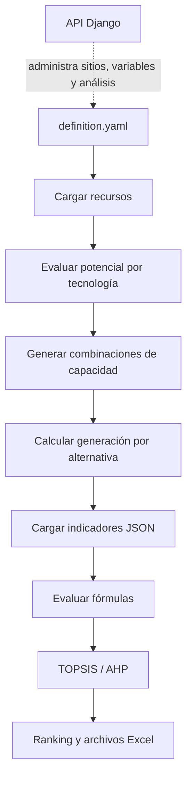

# ResearchDev: evaluación multicriterio de recursos renovables

ResearchDev es un prototipo de investigación para comparar alternativas de generación eléctrica renovable en un sitio determinado. Integra series temporales de recursos primarios, modelos simplificados de potencial energético, indicadores ambientales/económicos/técnicos/sociales y métodos de decisión multicriterio (MCDA), principalmente TOPSIS y, en el flujo heredado, AHP.

El objetivo de la propuesta es responder una pregunta de planificación: **dada una capacidad instalada y un conjunto de recursos disponibles, qué combinación de solar, eólica, hidráulica y biomasa ofrece el mejor compromiso entre desempeño técnico, costo, impacto ambiental y contribución social?**

> Estado: prototipo académico en evolución. El flujo de análisis por consola está más desarrollado que la API web; los resultados versionados son artefactos de experimentación y deben interpretarse junto con la definición del caso, los indicadores y las fuentes de datos.

## Contenido

- [Propuesta y alcance](#propuesta-y-alcance)
- [Flujo de análisis](#flujo-de-análisis)
- [Arquitectura](#arquitectura)
- [Estructura del repositorio](#estructura-del-repositorio)
- [Instalación](#instalación)
- [Ejecutar un caso de estudio](#ejecutar-un-caso-de-estudio)
- [Referencia técnica de instalación y ejecución](docs/REFERENCIA_TECNICA.md)
- [Configurar datos e indicadores](#configurar-datos-e-indicadores)
- [API Django](#api-django)
- [Notebook y exploración](#notebook-y-exploración)
- [Pruebas](#pruebas)
- [Salidas](#salidas)
- [Limitaciones y trabajo pendiente](#limitaciones-y-trabajo-pendiente)

## Propuesta y alcance

El sistema modela cuatro familias de recursos:

| Recurso    | Entrada principal                      | Tratamiento actual                                                            |
| ---------- | -------------------------------------- | ----------------------------------------------------------------------------- |
| Solar      | Irradiancia diaria NASA/PV             | Promedios mensuales, eficiencia y factores de temperatura/clima               |
| Eólico     | Velocidad del viento diaria            | Potencia aproximada con densidad del aire, área barrida y factor de capacidad |
| Hidráulico | Caudal IDEAM                           | Caudal ecológico, caudal de diseño, altura, eficiencia y factor de capacidad  |
| Biomasa    | Cultivos y actividad pecuaria en Excel | Disponibilidad de residuos y eficiencia de recolección/conversión             |

Cada alternativa es una distribución de la capacidad total entre los recursos habilitados. Las alternativas se evalúan mediante indicadores declarados en JSON. Cada indicador contiene una dimensión, unidad, fórmula, fuente, datos por tecnología y tipo `benefit` o `cost`. Después, TOPSIS normaliza los indicadores, aplica pesos y calcula un índice de similitud con la solución ideal; el ranking resultante se exporta a Excel.

Las dimensiones empleadas son:

- **Ambiental:** emisiones, ocupación del suelo, consumo de agua y otros impactos.
- **Económica:** LCOE, CAPEX, OPEX y costos asociados.
- **Técnica:** eficiencia, autonomía y capacidad de responder a la demanda.
- **Social:** empleo, aceptación/contribución local y efectos sobre la salud.

## Flujo de análisis



El flujo moderno de `main_2.py` es:

1. Leer la definición YAML del caso de estudio.
2. Crear objetos `Solar`, `Wind`, `Hydro` y `Biomass` según los recursos declarados.
3. Cargar CSV, archivos IDEAM `.data` o Excel mediante `ResourceVariable`.
4. Estimar la generación asociada a la capacidad instalada.
5. Generar combinaciones de participación con `Alternatives`.
6. Evaluar todos los indicadores mediante fórmulas procesadas por `numexpr`.
7. Ejecutar TOPSIS con ponderación difusa y escenarios de pesos.
8. Guardar las alternativas y el ranking en `case_studies/<caso>/results/`.

## Arquitectura

### Motor de dominio: `synergy/`

- `synergy/resources/`: entidades y modelos de solar, viento, hidro y biomasa; lectura y normalización de datos.
- `synergy/alternative.py`: generación de distribuciones de capacidad que suman la capacidad instalada.
- `synergy/indicator.py`: modelos Pydantic y evaluación de fórmulas de indicadores.
- `synergy/evaluation/mcda/`: criterios, normalización, TOPSIS y componentes históricos de AHP.
- `synergy/indicators_data.json`: catálogo de indicadores genérico.
- `synergy/tests/`: pruebas unitarias del generador de alternativas, indicadores y recursos.

### Aplicación de investigación: `main_2.py`

Es el punto de entrada histórico del flujo de investigación. Para nuevas ejecuciones se recomienda usar `run_analysis.py`, que permite seleccionar el caso sin editar código.

```bash
python run_analysis.py --case santa_rosalia
python run_analysis.py --case jamundi
python run_analysis.py --config case_studies/santa_rosalia/definition.yaml --seed 1 0.5 0
```

El runner reutilizable está en `synergy/runner.py`. `main_2.py` se conserva como referencia compatible con ejecuciones anteriores.

### API: `resource_synergy/`

Aplicación Django + Django Ninja que persiste sitios, variables de recurso, fuentes y análisis en SQLite. Expone una base para separar la captura de datos y la configuración de análisis del motor de cálculo. No reemplaza todavía el flujo de consola: la integración que ejecuta un análisis y persiste su resultado está incompleta.

### Flujo heredado: `main.py` y `evaluation/`

`main.py` conserva una API anterior (`PrimaryResource`, `ResourceViability`, `evaluation.*`) y referencias a módulos que ya no forman parte de la estructura visible actual. Sirve como antecedente del experimento, pero no es la ruta de ejecución recomendada.

## Estructura del repositorio

```text
.
├── main_2.py                         # Flujo moderno de análisis
├── main.py                           # Flujo heredado
├── requirements.txt                  # Dependencias Python
├── synergy/                          # Motor de dominio y MCDA
├── case_studies/                     # YAML, datos y resultados por sitio
│   ├── jamundi/
│   ├── santa_rosalia/
│   └── old_definitions/
├── data/                             # Datos auxiliares y fuentes históricas
├── analysis_result/                  # Notebook y resultados exploratorios
├── resource_synergy/                 # API Django + Django Ninja
├── Repo/Articulo1/                   # Encuestas, pruebas y salidas del artículo
├── requests.http                     # Ejemplos de solicitudes HTTP
└── pytest.ini                        # Configuración mínima de pytest
```

## Instalación

Se recomienda Python 3.10 o superior y un entorno virtual.

La guía detallada para preparar el entorno, validar dependencias, ejecutar Jamundí y Santa Rosalía, levantar la API y resolver errores frecuentes está en [docs/REFERENCIA_TECNICA.md](docs/REFERENCIA_TECNICA.md). Esta sección resume el camino rápido.

```bash
git clone <URL_DEL_REPOSITORIO>
cd ResearchDev
python -m venv .venv
source .venv/bin/activate
python -m pip install --upgrade pip
python -m pip install -r requirements.txt
```

En Windows, activar el entorno con `.venv\Scripts\activate`. La dependencia `pywaffle`, usada por el notebook, no está declarada en `requirements.txt`; instalarla aparte si se ejecutan esas celdas:

```bash
python -m pip install pywaffle
```

## Ejecutar un caso de estudio

Desde la raíz del repositorio:

```bash
python run_analysis.py --case santa_rosalia
```

Los casos incluidos son:

```text
python run_analysis.py --case santa_rosalia
python run_analysis.py --case jamundi
```

También se puede pasar una definición YAML propia:

```bash
python run_analysis.py --config case_studies/santa_rosalia/definition.yaml
```

El seed de participaciones puede sustituirse desde la línea de comandos:

```bash
python run_analysis.py --case santa_rosalia --seed 1 0.5 0
```

Esto es útil para una corrida rápida o una prueba controlada.

La definición debe proporcionar `CASE_STUDY`, `INSTALLED_CAPACITY`, `BIOMASS_REQUIREMENTS` y `RESOURCES`. Los recursos soportados son `solar`, `wind`, `hydro` y `biomass`. Cada bloque de recurso incluye un nombre y la ruta del archivo de entrada; el caso hidráulico puede incluir además la estación como metadato.

El proceso genera, entre otros, los siguientes archivos:

```text
case_studies/<caso>/results/alternatives_<n>.xlsx
case_studies/<caso>/results/ranking_of_<n>_alternatives.xlsx
```

`<n>` depende de la cantidad de recursos activos y de los valores contenidos en `seed`. No se debe asumir que siempre habrá 256, 1.680 o 3.126 alternativas.

## Configurar datos e indicadores

### Series de recursos

Los lectores de `synergy/resources/utils/csv_readers.py` reconocen:

- **NASA CSV:** columnas base `YEAR`, `MO`, `DY` y una columna `ALLSKY_SFC_SW_DWN` para solar o `WS10M` para viento.
- **IDEAM CSV:** el conjunto de columnas IDEAM esperado, incluyendo `IdParametro`, `Fecha` y `Valor`.
- **IDEAM `.data`:** CSV separado por `|` con columnas `Fecha` y `Valor`.
- **Biomasa Excel:** libro terminado en `biomass.xlsx` con las hojas `Historico Cultivos` y `Historico Pecuario` y sus columnas requeridas.

Las rutas declaradas en YAML son relativas a la raíz del repositorio. Antes de ejecutar, comprobar que cada archivo existe y que su extensión coincide con el lector seleccionado.

### Indicadores

Un indicador JSON sigue este esquema conceptual:

```json
{
	"id": 201,
	"name": "LCOE",
	"dimension": "economic",
	"description": "Costo nivelado de la energía",
	"source": "",
	"data": { "solar": 202.94, "wind": 76.28, "hydro": 124.97, "biomass": 72 },
	"year": "2015",
	"unit": "USD/MWh",
	"type_indicator": "cost",
	"formula": "(solar_generation * 202.94 + wind_generation * 76.28 + hydro_generation * 124.97 + biomass_generation * 72) / (solar_generation + wind_generation + hydro_generation + biomass_generation)"
}
```

`main_2.py` usa el archivo indicado por `INDICATORS` en el YAML. Si la clave no existe, usa `synergy/indicators_data.json`. El caso Santa Rosalía tiene su propio catálogo en `case_studies/santa_rosalia/indicators.json`.

Las fórmulas se evalúan con `numexpr`; por tanto, las variables usadas deben existir en el diccionario de la alternativa. Revisar unidades, año, fuente y orientación `cost`/`benefit` antes de comparar resultados.

## API Django

La API se ejecuta desde su directorio de proyecto:

```bash
cd resource_synergy
python manage.py migrate
python manage.py runserver
```

La API queda disponible en `http://127.0.0.1:8000/api/v1/`. La documentación interactiva de Django Ninja suele estar en `http://127.0.0.1:8000/api/v1/docs`.

Rutas principales:

| Recurso                                             | Operaciones implementadas                                      |
| --------------------------------------------------- | -------------------------------------------------------------- |
| `/api/v1/analysis/`                                 | Listar, crear, consultar, actualizar, eliminar y asociar sitio |
| `/api/v1/site/`                                     | Listar, crear, consultar, actualizar y eliminar sitios         |
| `/api/v1/site/{id}/resource`                        | Consultar variables asociadas a un sitio                       |
| `/api/v1/site/{id}/set-resources/`                  | Asociar variables existentes a un sitio                        |
| `/api/v1/site/{id}/resource/{resource_id}/set-data` | Actualizar la serie temporal de una variable                   |
| `/api/v1/source/`                                   | Listar fuentes                                                 |

Hay ejemplos de payloads en [requests.http](requests.http). La API usa SQLite local (`resource_synergy/db.sqlite3`) y está configurada para desarrollo. Antes de desplegarla se deben cambiar la clave secreta, `DEBUG`, `ALLOWED_HOSTS`, CORS y la configuración de base de datos.

## Notebook y exploración

[analysis_result/data_exploration_01.ipynb](analysis_result/data_exploration_01.ipynb) contiene exploraciones de correlación, heatmaps, rankings, TOPSIS, gráficos de alternativas y visualizaciones tipo waffle. Está orientado al análisis posterior de archivos Excel ya generados, no al pipeline mínimo de ejecución.

Para abrirlo:

```bash
jupyter lab analysis_result/data_exploration_01.ipynb
```

Varias celdas usan rutas relativas a la raíz y esperan que el notebook se ejecute con un directorio de trabajo compatible. Si una celda no encuentra `case_studies` o `synergy`, revisar el directorio de trabajo del kernel.

## Pruebas

Las pruebas del motor están en `synergy/tests/`. Ejecutarlas con:

```bash
python -m pytest -q
```

El archivo `pytest.ini` solo configura el filtrado de advertencias. La cobertura existente se concentra en alternativas, indicadores y recursos; la API y el pipeline completo todavía requieren pruebas de integración.

## Salidas

Las salidas de investigación se distribuyen en tres grupos:

- `case_studies/<caso>/results/`: alternativas evaluadas y rankings TOPSIS.
- `Repo/Articulo1/output/`: resultados del flujo MCDA utilizado en el artículo y sus escenarios de prueba.
- `analysis_result/`: notebook y archivos derivados de exploración.

Los archivos Excel de resultados pueden contener diferentes números de alternativas porque corresponden a ejecuciones con distintos `seed`, casos o configuraciones. No deben confundirse con una única corrida canónica.

## Limitaciones y trabajo pendiente

1. **Separación de capas:** el motor, la API y el notebook evolucionaron en momentos distintos; la API todavía no dispara el cálculo del motor ni persiste un `SynergyResult` completo.
2. **Configuración del script:** `main_2.py` fija la ruta del YAML y usa arreglos separados para cada tecnología. La generación de alternativas debería hacerse de forma dinámica cuando se habilite un subconjunto de recursos.
3. **Validación científica:** varios parámetros de eficiencia, capacidad, costos y factores de impacto están codificados en el modelo o en JSON. Hace falta trazabilidad sistemática de fuentes, unidades, años y análisis de sensibilidad.
4. **Reproducibilidad:** los resultados versionados se mezclan con artefactos generados localmente. Conviene definir una corrida de referencia, un archivo de entorno y una política para resultados derivados.
5. **Calidad de datos:** los lectores aceptan formatos muy específicos y algunas rutas históricas usan extensiones diferentes (`.csv`, `.data`, `.xlsx`). Validar esquema y disponibilidad antes de cada ejecución.
6. **Seguridad de la API:** `DEBUG=True`, la clave secreta está en configuración y no hay autenticación documentada. El servicio solo debe tratarse como entorno local de desarrollo.
7. **Flujo heredado:** `main.py` depende de la antigua estructura `evaluation/` y no debe utilizarse como punto de entrada sin recuperar o migrar esas dependencias.

## Próximos pasos recomendados

- Extraer la configuración del caso y los parámetros de ejecución a argumentos CLI.
- Crear un servicio de aplicación que conecte la API con `synergy` y persista resultados.
- Hacer dinámico el cálculo de generaciones y la creación de columnas por recurso.
- Añadir pruebas de integración para un caso completo y validadores de YAML/CSV/Excel.
- Incorporar análisis de sensibilidad de pesos, indicadores y parámetros de recurso.
- Separar resultados generados de datos fuente y documentar una corrida reproducible.
